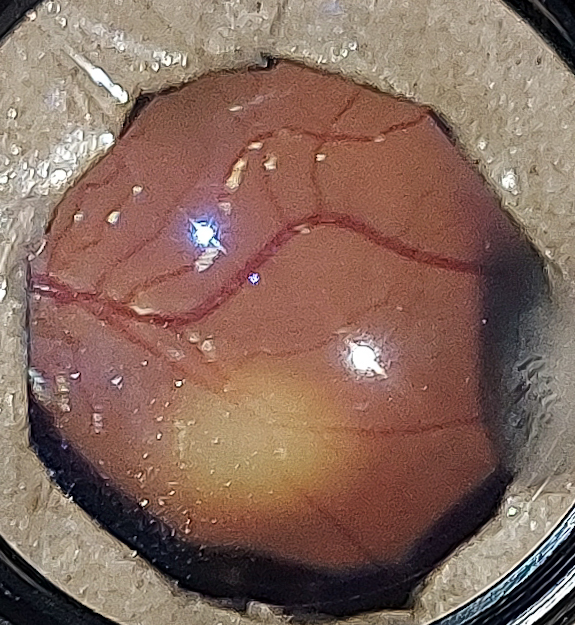

# GoMoDiarect: On-The-Go Edge Vision System for Diabetic Retinopathy Screening

[](LICENSE)
[](https://www.python.org/)
[](https://flask.palletsprojects.com/)
[](https://www.raspberrypi.com/)

**GoMoDiarect** is an end-to-end medical IoT and deep learning diagnostic system for automated, low-cost screening of **Diabetic Retinopathy (DR)** from retinal fundus photographs. 

Traditional desktop fundus cameras cost upwards of $5,000–$25,000, creating severe screening bottlenecks in underserved and remote clinical settings. GoMoDiarect bridges this gap by pairing a **custom optical eyewear prototype** (Raspberry Pi Zero 2W + 20D ophthalmic condensing lens) with a **mobile client** and a **cloud/local deep learning inference engine** to classify diabetic retinopathy into 5 clinical stages in real time.

---

## System Architecture

```mermaid
flowchart LR
    subgraph Hardware ["1. Edge Eyewear Module"]
        direction TB
        A["Patient Retina"] --> B["20D Condensing Lens"]
        B --> C["ArduCam 16MP (IMX519)"]
        C --> D["Raspberry Pi Zero 2W"]
        D --> E["TCP Socket Streaming Server"]
    end

    subgraph Client ["2. Mobile Application"]
        direction TB
        E -->|Local WiFi Socket| F["Flutter Mobile App"]
        F --> G["Image Review & Pre-Inspection"]
        G --> H["Cloud/Server Upload"]
    end

    subgraph Backend ["3. Inference Microservice"]
        direction TB
        H -->|POST /predict| I["Flask REST API"]
        I --> J["Luminance Preprocessing & Normalization"]
        J --> K["Transfer-Learned CNN Backbone<br>(EfficientNet-B5 / ResNet50)"]
        K --> L["Diagnostic Grade (0–4) + Probabilities"]
        L -->|JSON Response| F
    end
```



---

## Prototype In Vivo Optical Capture

To evaluate the optical feasibility of accessible fundus photography, test captures were acquired through the prototype optical assembly (coupling a 20D indirect ophthalmic condensing lens with the sensor and targeted illumination).

<p align="center">
  
  <br>
  <em><b>Figure 1:</b> Sample retinal fundus capture acquired through the 20D condensing lens optical assembly, demonstrating visible retinal vascular branching across the posterior pole, circular optical aperture framing, and characteristic Purkinje illumination reflections.</em>
</p>

---

## Key Features

1. **Portable Optical Capture Hardware:**
   - Mounts a **20D ophthalmic indirect condensing lens** aligned with an **ArduCam 16MP Sony IMX519** sensor on a lightweight eyewear frame.
   - Powered by an ultra-compact **Raspberry Pi Zero 2W** executing an automated socket streaming daemon on system boot.
   - Provides physical push-button and software-triggered shutter capture with low-latency image transfer over TCP sockets.

2. **Computer Vision & Diagnostic Engine:**
   - Evaluated on the **APTOS 2019 Blindness Detection** benchmark dataset collected by Aravind Eye Hospital.
   - Evaluates transfer-learned convolutional architectures (**EfficientNet-B5** with Group Normalization for small-batch stabilization, and **ResNet50**).
   - Classifies retinal fundus captures into the 5 standard international clinical stages of Diabetic Retinopathy.

3. **Production-Grade Microservice Backend:**
   - Lightweight, decoupled Flask REST API featuring cross-platform path handling, automated luminance channel normalization, and structured JSON diagnostics.
   - Health monitoring endpoint (`/health`) for cluster orchestrators and edge device heartbeats.

---

## Clinical Diagnostic Grading Scale

GoMoDiarect maps captured fundus images against the International Clinical Diabetic Retinopathy Disease Severity Scale:

| Grade | Clinical Condition | Pathological Indicators |
| :---: | :--- | :--- |
| **0** | **No Diabetic Retinopathy** | Normal retina; no visible vascular abnormalities. |
| **1** | **Mild Non-Proliferative DR (NPDR)** | Microaneurysms only (isolated small red dots). |
| **2** | **Moderate NPDR** | Microaneurysms, hard exudates, cotton-wool spots, intraretinal hemorrhages. |
| **3** | **Severe NPDR** | Extensive hemorrhages in 4 quadrants, venous beading in 2+ quadrants, or IRMA. |
| **4** | **Proliferative DR (PDR)** | Neovascularization (new abnormal blood vessels), preretinal/vitreous hemorrhage. |

---

## Repository Structure

```text
GoMoDiarect/
├── README.md                  # Comprehensive technical documentation & BOM
├── LICENSE                    # MIT License
├── requirements.txt           # Python backend dependencies
├── .gitignore                 # Excludes heavy binaries, APKs, and model weights
├── server/                    # Flask REST inference microservice
│   ├── app.py                 # Cleaned inference server API (POST /predict, GET /health)
│   ├── evaluate.py            # Quantitative metric evaluation (QWK, Accuracy, ConfMat)
│   └── preprocess.py          # Luminance conversion, 3-channel alignment, normalization
├── hardware/                  # Edge hardware capture implementation
│   └── pi_zero/
│       ├── main.py            # Socket server listening for capture/stream triggers
│       ├── clickutil.py       # Camera shutter and GPIO integration
│       ├── startup.sh         # Systemd boot script for headless execution
│       └── sockets/           # Direct TCP socket sender/receiver utilities
├── mobile/                    # Mobile client interface
│   └── application.dart       # Flutter integration for socket listener and REST calls
├── notebooks/                 # Model evaluation and experimentation
│   └── transfer_learning_evaluation.ipynb # Transfer learning benchmark (adapted from Carlo Lepelaars' baseline)
└── docs/                      # Architectural diagrams, sample captures, and hardware notes
    └── sample_captured_fundus.jpg
```

---

## Hardware Bill of Materials (BOM)

| Component | Specification | Function |
| :--- | :--- | :--- |
| **Single-Board Computer** | Raspberry Pi Zero 2W (512MB RAM, Quad-core ARM Cortex-A53) | Runs headless OS, WiFi AP/client, and socket streaming daemon. |
| **Camera Sensor** | ArduCam 16MP Sony IMX519 Autofocus Module | High-resolution macro capture of the retinal image plane. |
| **Condensing Lens** | 20D Ophthalmic Indirect Condensing Lens | Aerial image formation of the fundus through pupil dilation. |
| **Housing / Mount** | Eyewear frame / 3D-printed enclosure | Aligns optics, focal distance, and sensor orientation. |
| **Power Supply** | 5V / 2.5A USB power bank | Mobile, battery-powered portable operation. |

---

## Getting Started

### 1. Inference Server Setup

```bash
# Clone the repository
git clone https://github.com/naman-chopra/GoMoDiarect.git
cd GoMoDiarect

# Create and activate virtual environment
python3 -m venv venv
source venv/bin/activate

# Install dependencies
pip install -r requirements.txt
```

Place your trained Keras model weights (`resnet_model.h5` or `effnet_modelB5.h5`) in `server/models/` (or configure via `MODEL_PATH`):

```bash
# Start the inference server
cd server
python3 app.py
```

### 2. Testing the API

```bash
# Health check
curl http://localhost:5000/health

# Run prediction on a fundus image
curl -X POST -F "image=@sample_fundus.png" http://localhost:5000/predict
```

Example JSON Response:
```json
{
  "status": "success",
  "file": "sample_fundus.png",
  "prediction": {
    "grade": 2,
    "classification": "Moderate Non-Proliferative DR",
    "stage_code": "Grade 2",
    "probabilities": [0.03, 0.12, 0.78, 0.05, 0.02]
  }
}
```

### 3. Raspberry Pi Zero 2W Setup

Deploy the `hardware/pi_zero/` directory onto the Pi Zero 2W. Ensure camera interfaces (`libcamera` or legacy camera stack) are enabled via `raspi-config`:

```bash
cd hardware/pi_zero
chmod +x startup.sh
./startup.sh
```

### 4. Offline Model Evaluation & Metrics Verification

To evaluate a trained model checkpoint against holdout ground truth data and compute Quadratic Weighted Kappa (QWK), classification accuracy, and confusion matrices:

```bash
cd server
python3 evaluate.py \
  --model models/effnet_modelB5.h5 \
  --labels ../data/test.csv \
  --images ../data/test_images/
```

---

## Baseline Attribution & Dataset Credits

* **APTOS 2019 Blindness Detection Dataset:** Generously provided by the [Aravind Eye Hospital](https://www.aravind.org/) via Kaggle for diabetic retinopathy research.
* **Exploratory Model Baseline:** The offline transfer-learning exploration notebook ([`notebooks/transfer_learning_evaluation.ipynb`](notebooks/transfer_learning_evaluation.ipynb)) was adapted from the public Kaggle baseline by **Carlo Lepelaars** (*EfficientNetB5 for the APTOS 2019 competition with Keras*). The GoMoDiarect team adapted this framework to benchmark ImageNet pre-trained backbones (EfficientNet, ResNet), stabilize small-batch training via Group Normalization and RAdam, and export calibrated checkpoint weights into the edge deployment pipeline.
* **EfficientNet Architecture:** Tan, M., & Le, Q. V. (2019). *EfficientNet: Rethinking Model Scaling for Convolutional Neural Networks.* ICML 2019. [arXiv:1905.11946](https://arxiv.org/abs/1905.11946).

---

## Research Context & Related Work

* **Karthik, Maggie, Sohier Dane.** [APTOS 2019 Blindness Detection](https://kaggle.com/competitions/aptos2019-blindness-detection). Kaggle.
* **Rajalakshmi, R. et al.** (2018). *Automated diabetic retinopathy detection in smartphone-based fundus photography using artificial intelligence.* **Eye** 32, 1138–1144.
* **Gulshan, V. et al.** (2016). *Development and Validation of a Deep Learning Algorithm for Detection of Diabetic Retinopathy in Retinal Fundus Photographs.* **JAMA** 316(22):2402–2410.

---

## License

This project is licensed under the [MIT License](LICENSE).
